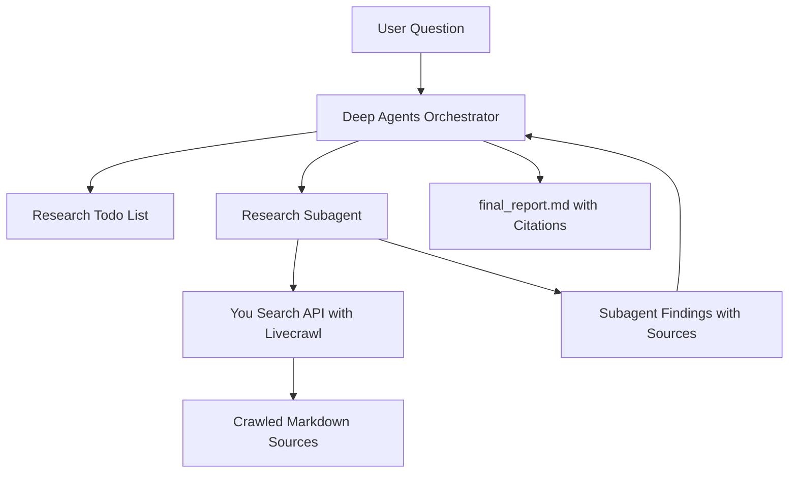

# You.com Deep Research Tutorial Plan

## Scope
Create a runnable tutorial and walkthrough in the current skeleton repo:

- [`agent.py`](agent.py): runnable Deep Agents research agent using Anthropic plus You Search API livecrawl.
- [`pyproject.toml`](pyproject.toml): minimal Python project dependencies, replacing `tavily-python`, `httpx`, and `markdownify` with `youdotcom`.
- [`.env.example`](.env.example): required env vars for `ANTHROPIC_API_KEY`, `YDC_API_KEY`, and optional `LANGSMITH_API_KEY`.
- [`README.md`](README.md): tutorial-style guide mirroring the LangChain Deep Research flow, rewritten around You.com APIs.

## Implementation Shape

Use the same high-level flow as the LangChain tutorial:

In [`agent.py`](agent.py), define a `you_search` LangChain tool that:

- Initializes `You(api_key_auth=os.environ["YDC_API_KEY"])` from `youdotcom`.
- Calls `you.search.unified(...)` with `livecrawl=LiveCrawl.WEB` and `livecrawl_formats=LiveCrawlFormats.MARKDOWN`.
- Returns formatted results containing title, URL, description/snippets, and crawled Markdown content.
- Falls back to snippets/description when a page does not return livecrawl content.
- Keeps the original tutorial's subagent pattern: orchestrator delegates research, subagent uses the search tool, final report is written with citations.

The prompts will be updated only where needed:

- Replace `tavily_search` references with `you_search`.
- Explain that You Search livecrawl retrieves full page content directly, so no separate `fetch_webpage_content` helper is needed.
- Keep the same planning, delegation limits, citation consolidation, and final report requirements.

## README Tutorial

Rewrite [`README.md`](README.md) as a self-contained tutorial with:

- Overview and goals matching the original Deep Research tutorial.
- You.com-specific prerequisites and API key setup.
- Install instructions using the local project dependency config.
- Explanation of Search API + livecrawl and why it replaces Tavily plus manual fetching.
- Run instructions for the Anthropic default path.
- Short notes on Contents API and Research API as related You.com APIs, without making them part of the primary agent since you chose Search + livecrawl as the main architecture.

## Validation

After implementation is approved, I’ll run lightweight checks only:

- Python syntax/compile check for [`agent.py`](agent.py).
- If API keys are present in the environment, a small live `you_search` smoke test with `count=1`.
- Linter diagnostics for edited files.
