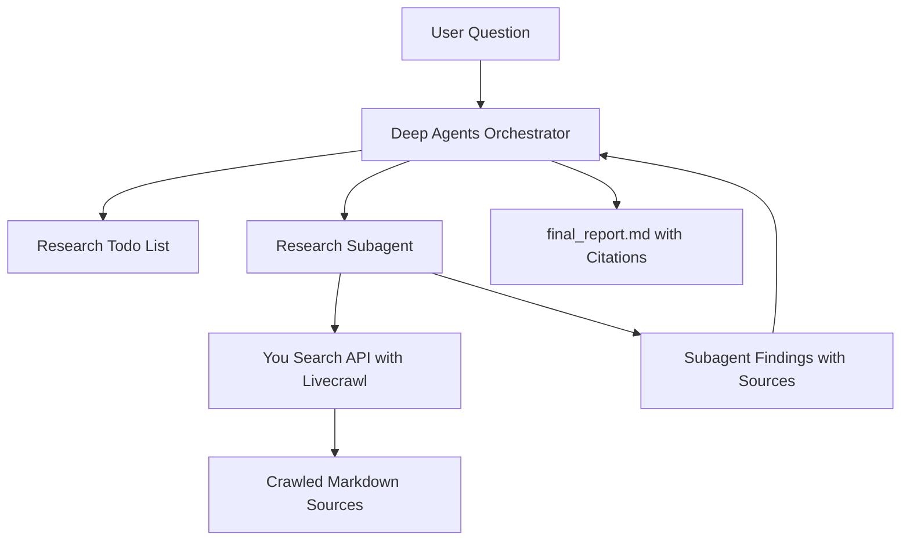

# Build a Deep Research Agent with LangChain and You.com

This tutorial builds a multi-step web research agent using [LangChain Deep Agents](https://docs.langchain.com/oss/python/deepagents) and the official [You.com Python SDK](https://you.com/docs/sdks/python-sdk).

The agent plans research tasks, delegates focused searches to a subagent, reads full web page content through You.com Search API livecrawl, and synthesizes a cited report.

## What You Will Build

The agent will:

1. Plan research with a todo list.
2. Delegate focused research tasks to a subagent with isolated context.
3. Search the web with You.com Search API.
4. Use `livecrawl` to retrieve full page Markdown for search results.
5. Synthesize findings into a final report with consolidated citations.

The original LangChain tutorial uses Tavily to discover URLs and then manually fetches each page. This version uses You.com Search API with `livecrawl`, so URL discovery and page-content retrieval happen in one API call.

## Prerequisites

You need API keys for:

- Anthropic, for the Claude model.
- You.com, for Search API with livecrawl.
- LangSmith, optional, for tracing.

Create a You.com API key from [you.com/platform](https://you.com/platform).

## Setup

Run these commands from the repository root.

Create and activate a virtual environment:

```bash
python -m venv .venv
source .venv/bin/activate
```

Install the project dependencies:

```bash
pip install -e .
```

Or, with `uv`:

```bash
uv sync
```

Create your local `.env` file:

```bash
cp .env.example .env
```

Edit `.env` and add your keys:

```bash
ANTHROPIC_API_KEY=your_anthropic_api_key
YDC_API_KEY=your_you_com_api_key
LANGSMITH_API_KEY=your_langsmith_api_key
```

`LANGSMITH_API_KEY` is optional. Leave it blank or remove it if you do not want tracing.

## How the You.com Search Tool Works

The `you_search` tool in `agent.py` calls the official SDK:

```python
from youdotcom import You
from youdotcom.models import LiveCrawl, LiveCrawlFormats

with You(api_key_auth=os.environ["YDC_API_KEY"]) as you:
    search_results = you.search.unified(
        query=query,
        count=max_results,
        livecrawl=LiveCrawl.WEB,
        livecrawl_formats=LiveCrawlFormats.MARKDOWN,
    )
```

`livecrawl=LiveCrawl.WEB` tells You.com to crawl the web results and return page content. `livecrawl_formats=LiveCrawlFormats.MARKDOWN` asks for clean Markdown, which is easier for an LLM research agent to analyze than raw HTML.

If a page cannot be crawled, the tool falls back to the result snippets or description so the subagent can still use the search result.

## Agent Architecture

The Deep Agents orchestrator does not search directly. It creates a plan, saves the user's request, delegates research to the subagent, then writes a final cited report.

The research subagent uses only the `you_search` tool. It starts broad, narrows the query when needed, and stops once it has enough evidence.



## Run the Agent

Run the default research question and stream updates as the agent works:

```bash
python agent.py
```

Or provide your own question:

```bash
RESEARCH_QUESTION="Compare RAG and fine-tuning for enterprise LLM applications" python agent.py
```

With `uv`, use:

```bash
RESEARCH_QUESTION="Compare RAG and fine-tuning for enterprise LLM applications" uv run python agent.py
```

The script uses `agent.stream(..., stream_mode="updates")`, so you will see messages as the orchestrator and research subagent make progress instead of waiting for the final result only.

During a run, the agent writes working files to the repository root through a Deep Agents `FilesystemBackend`:

- `research_request.md`
- `final_report.md`

If `LANGSMITH_API_KEY` is set, you can inspect the trace in LangSmith to see the orchestration, subagent delegation, and You.com search calls.

## Related You.com APIs

This tutorial uses Search API with livecrawl as the primary replacement for Tavily because it preserves the original Deep Research architecture: the LangChain agent still controls the research loop, query strategy, source evaluation, and synthesis.

You.com also provides two related APIs:

- Contents API extracts Markdown, HTML, or metadata from URLs you already know. Use it when you do not need search.
- Research API returns a synthesized cited answer directly. Use it when you want You.com to perform the research loop for you instead of building that loop with Deep Agents.

Those APIs are useful extensions, but this tutorial keeps Search API livecrawl as the core tool so developers learn how to build the agentic research workflow themselves.

## Customize

You can adjust the behavior in `agent.py`:

- Change `max_concurrent_research_units` to allow more or fewer parallel subagents.
- Change `max_researcher_iterations` to allow more delegation rounds.
- Tune the researcher prompt if you want broader or narrower search behavior.
- Change the Claude model in the `ChatAnthropic` initialization.
